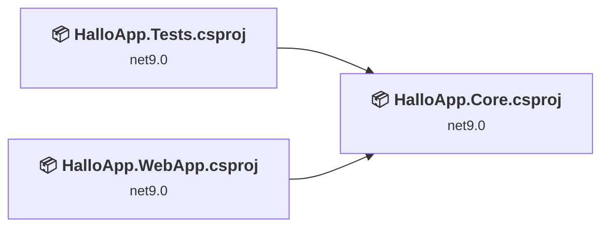
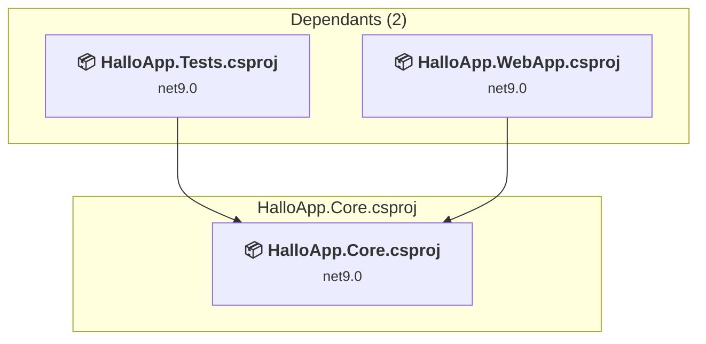
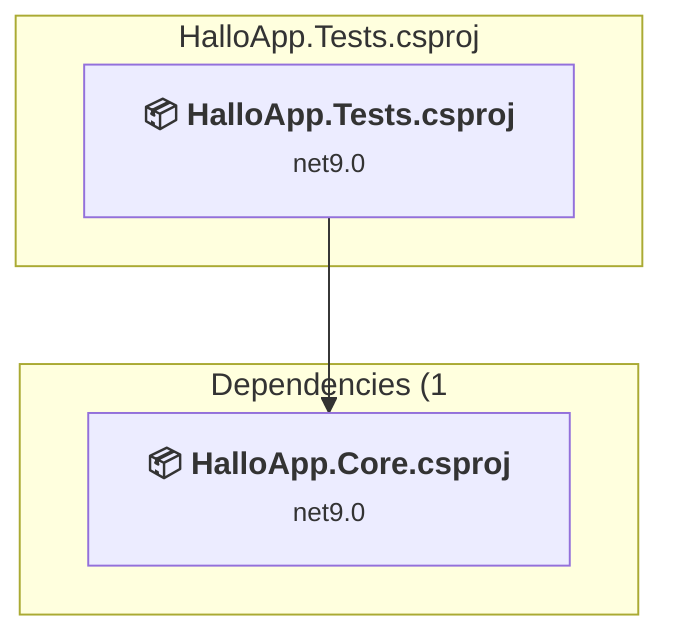
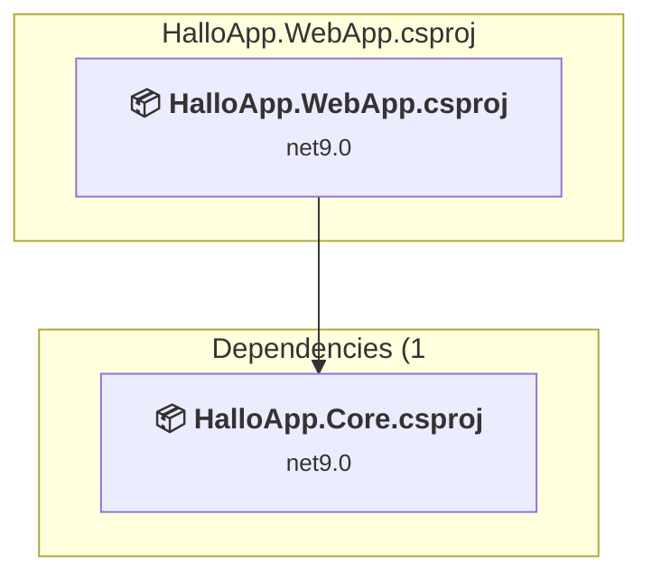

# Projects and dependencies analysis

This document provides a comprehensive overview of the projects and their dependencies in the context of upgrading to .NETCoreApp,Version=v10.0.

## Table of Contents

- [Executive Summary](#executive-Summary)
  - [Highlevel Metrics](#highlevel-metrics)
  - [Projects Compatibility](#projects-compatibility)
  - [Package Compatibility](#package-compatibility)
  - [API Compatibility](#api-compatibility)
  - [Binding Redirect Configuration](#binding-redirect-configuration)
- [Aggregate NuGet packages details](#aggregate-nuget-packages-details)
- [Top API Migration Challenges](#top-api-migration-challenges)
  - [Technologies and Features](#technologies-and-features)
  - [Most Frequent API Issues](#most-frequent-api-issues)
- [Projects Relationship Graph](#projects-relationship-graph)
- [Project Details](#project-details)

  - [HalloApp.Core\HalloApp.Core.csproj](#halloappcorehalloappcorecsproj)
  - [HalloApp.Tests\HalloApp.Tests.csproj](#halloapptestshalloapptestscsproj)
  - [HalloApp.WebApp\HalloApp.WebApp.csproj](#halloappwebapphalloappwebappcsproj)

## Executive Summary

### Highlevel Metrics

| Metric | Count | Status |
| :--- | :---: | :--- |
| Total Projects | 3 | All require upgrade |
| Total NuGet Packages | 9 | 7 need upgrade |
| Total Code Files | 195 |  |
| Total Code Files with Incidents | 6 |  |
| Total Lines of Code | 31921 |  |
| Total Number of Issues | 22 |  |
| Estimated LOC to modify | 10+ | at least 0,0% of codebase |

### Projects Compatibility

| Project | Target Framework | Difficulty | Package Issues | API Issues | Binding Issues | Est. LOC Impact | Description |
| :--- | :---: | :---: | :---: | :---: | :---: | :---: | :--- |
| [HalloApp.Core\HalloApp.Core.csproj](#halloappcorehalloappcorecsproj) | net9.0 | 🟢 Low | 2 | 0 | 0 |  | ClassLibrary, Sdk Style = True |
| [HalloApp.Tests\HalloApp.Tests.csproj](#halloapptestshalloapptestscsproj) | net9.0 | 🟢 Low | 2 | 0 | 0 |  | DotNetCoreApp, Sdk Style = True |
| [HalloApp.WebApp\HalloApp.WebApp.csproj](#halloappwebapphalloappwebappcsproj) | net9.0 | 🟢 Low | 5 | 10 | 0 | 10+ | AspNetCore, Sdk Style = True |

### Package Compatibility

| Status | Count | Percentage |
| :--- | :---: | :---: |
| ✅ Compatible | 2 | 22,2% |
| ⚠️ Incompatible | 1 | 11,1% |
| 🔄 Upgrade Recommended | 6 | 66,7% |
| ***Total NuGet Packages*** | ***9*** | ***100%*** |

### API Compatibility

| Category | Count | Impact |
| :--- | :---: | :--- |
| 🔴 Binary Incompatible | 4 | High - Require code changes |
| 🟡 Source Incompatible | 4 | Medium - Needs re-compilation and potential conflicting API error fixing |
| 🔵 Behavioral change | 2 | Low - Behavioral changes that may require testing at runtime |
| ✅ Compatible | 61806 |  |
| ***Total APIs Analyzed*** | ***61816*** |  |

## Aggregate NuGet packages details

| Package | Current Version | Suggested Version | Projects | Description |
| :--- | :---: | :---: | :--- | :--- |
| Microsoft.AspNetCore.Identity.EntityFrameworkCore | 9.0.0 | 10.0.10 | [HalloApp.Core.csproj](#halloappcorehalloappcorecsproj) [HalloApp.WebApp.csproj](#halloappwebapphalloappwebappcsproj) | Ein NuGet-Paketupgrade wird empfohlen |
| Microsoft.EntityFrameworkCore | 9.0.0 | 10.0.10 | [HalloApp.Core.csproj](#halloappcorehalloappcorecsproj) [HalloApp.WebApp.csproj](#halloappwebapphalloappwebappcsproj) | Ein NuGet-Paketupgrade wird empfohlen |
| Microsoft.EntityFrameworkCore.Design | 9.0.0 | 10.0.10 | [HalloApp.WebApp.csproj](#halloappwebapphalloappwebappcsproj) | Ein NuGet-Paketupgrade wird empfohlen |
| Microsoft.EntityFrameworkCore.InMemory | 9.0.0 | 10.0.10 | [HalloApp.Tests.csproj](#halloapptestshalloapptestscsproj) | Ein NuGet-Paketupgrade wird empfohlen |
| Microsoft.EntityFrameworkCore.SqlServer | 9.0.0 | 10.0.10 | [HalloApp.WebApp.csproj](#halloappwebapphalloappwebappcsproj) | Ein NuGet-Paketupgrade wird empfohlen |
| Microsoft.EntityFrameworkCore.Tools | 9.0.0 | 10.0.10 | [HalloApp.WebApp.csproj](#halloappwebapphalloappwebappcsproj) | Ein NuGet-Paketupgrade wird empfohlen |
| Microsoft.NET.Test.Sdk | 17.11.1 |  | [HalloApp.Tests.csproj](#halloapptestshalloapptestscsproj) | ✅Compatible |
| xunit | 2.9.2 |  | [HalloApp.Tests.csproj](#halloapptestshalloapptestscsproj) | ⚠️Das NuGet-Paket ist veraltet |
| xunit.runner.visualstudio | 2.8.2 |  | [HalloApp.Tests.csproj](#halloapptestshalloapptestscsproj) | ✅Compatible |

## Top API Migration Challenges

### Technologies and Features

| Technology | Issues | Percentage | Migration Path |
| :--- | :---: | :---: | :--- |

### Most Frequent API Issues

| API | Count | Percentage | Category |
| :--- | :---: | :---: | :--- |
| M:Microsoft.Extensions.DependencyInjection.OptionsConfigurationServiceCollectionExtensions.Configure''1(Microsoft.Extensions.DependencyInjection.IServiceCollection,Microsoft.Extensions.Configuration.IConfiguration) | 3 | 30,0% | Binary Incompatible |
| M:System.TimeSpan.FromSeconds(System.Int64) | 2 | 20,0% | Source Incompatible |
| T:System.Uri | 1 | 10,0% | Behavioral Change |
| M:Microsoft.AspNetCore.Builder.ExceptionHandlerExtensions.UseExceptionHandler(Microsoft.AspNetCore.Builder.IApplicationBuilder,System.String,System.Boolean) | 1 | 10,0% | Behavioral Change |
| M:Microsoft.Extensions.Configuration.ConfigurationBinder.GetValue''1(Microsoft.Extensions.Configuration.IConfiguration,System.String) | 1 | 10,0% | Binary Incompatible |
| T:Microsoft.Extensions.DependencyInjection.IdentityEntityFrameworkBuilderExtensions | 1 | 10,0% | Source Incompatible |
| M:Microsoft.Extensions.DependencyInjection.IdentityEntityFrameworkBuilderExtensions.AddEntityFrameworkStores''1(Microsoft.AspNetCore.Identity.IdentityBuilder) | 1 | 10,0% | Source Incompatible |

## Projects Relationship Graph

Legend:
📦 SDK-style project
⚙️ Classic project

## Project Details

### HalloApp.Core\HalloApp.Core.csproj

#### Project Info

- **Current Target Framework:** net9.0
- **Proposed Target Framework:** net10.0
- **SDK-style**: True
- **Project Kind:** ClassLibrary
- **Dependencies**: 0
- **Dependants**: 2
- **Number of Files**: 137
- **Number of Files with Incidents**: 1
- **Lines of Code**: 7431
- **Estimated LOC to modify**: 0+ (at least 0,0% of the project)

#### Dependency Graph

Legend:
📦 SDK-style project
⚙️ Classic project

### API Compatibility

| Category | Count | Impact |
| :--- | :---: | :--- |
| 🔴 Binary Incompatible | 0 | High - Require code changes |
| 🟡 Source Incompatible | 0 | Medium - Needs re-compilation and potential conflicting API error fixing |
| 🔵 Behavioral change | 0 | Low - Behavioral changes that may require testing at runtime |
| ✅ Compatible | 9814 |  |
| ***Total APIs Analyzed*** | ***9814*** |  |

### HalloApp.Tests\HalloApp.Tests.csproj

#### Project Info

- **Current Target Framework:** net9.0
- **Proposed Target Framework:** net10.0
- **SDK-style**: True
- **Project Kind:** DotNetCoreApp
- **Dependencies**: 1
- **Dependants**: 0
- **Number of Files**: 21
- **Number of Files with Incidents**: 1
- **Lines of Code**: 3389
- **Estimated LOC to modify**: 0+ (at least 0,0% of the project)

#### Dependency Graph

Legend:
📦 SDK-style project
⚙️ Classic project

### API Compatibility

| Category | Count | Impact |
| :--- | :---: | :--- |
| 🔴 Binary Incompatible | 0 | High - Require code changes |
| 🟡 Source Incompatible | 0 | Medium - Needs re-compilation and potential conflicting API error fixing |
| 🔵 Behavioral change | 0 | Low - Behavioral changes that may require testing at runtime |
| ✅ Compatible | 4970 |  |
| ***Total APIs Analyzed*** | ***4970*** |  |

### HalloApp.WebApp\HalloApp.WebApp.csproj

#### Project Info

- **Current Target Framework:** net9.0
- **Proposed Target Framework:** net10.0
- **SDK-style**: True
- **Project Kind:** AspNetCore
- **Dependencies**: 1
- **Dependants**: 0
- **Number of Files**: 100
- **Number of Files with Incidents**: 4
- **Lines of Code**: 21101
- **Estimated LOC to modify**: 10+ (at least 0,0% of the project)

#### Dependency Graph

Legend:
📦 SDK-style project
⚙️ Classic project

### API Compatibility

| Category | Count | Impact |
| :--- | :---: | :--- |
| 🔴 Binary Incompatible | 4 | High - Require code changes |
| 🟡 Source Incompatible | 4 | Medium - Needs re-compilation and potential conflicting API error fixing |
| 🔵 Behavioral change | 2 | Low - Behavioral changes that may require testing at runtime |
| ✅ Compatible | 47022 |  |
| ***Total APIs Analyzed*** | ***47032*** |  |

